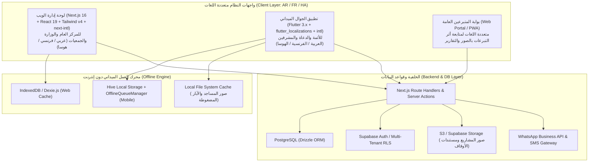
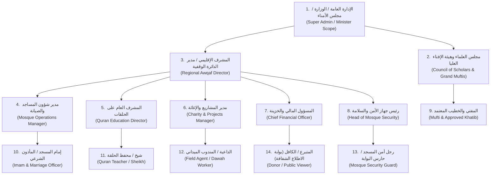
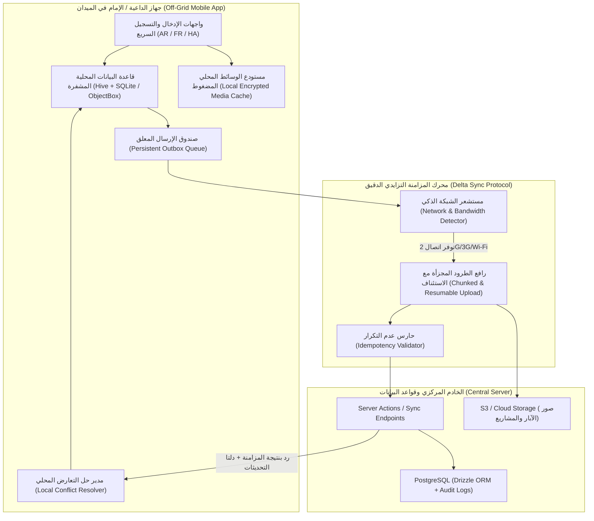

# خطة التطوير الشاملة والواسعة: منصة "منارة" (Manara Awqaf & Dawah ERP)
## المنظومة المتكاملة لإدارة المراكز الخيرية والدعوية ورعاية المساجد وحلقات القرآن الكريم

---

## 📌 1. الرؤية العامة والأهداف الاستراتيجية (Executive Summary)

**منصة "منارة" (Manara)** هي منظومة هجينة سحابية وميدانية متقدمة (Web Dashboard + Offline-First Mobile App)، صُممت لتكون الحل المؤسسي الشامل للجمعيات الخيرية، الهيئات الوقفية، إدارات الشؤون الدينية، والمنظمات الدعوية، مع **دعم كامل لثلاث لغات رسمية وميدانية: العربية، الفرنسية، والهوسا (Hausa)**.

### الأهداف الأساسية:
1. **حوكمة بيوت الله ورعايتها**: حصر المساجد، أئمتها ومؤذنيها، خطط الصيانة، واحتياجات الطاقة والمياه والأثاث.
2. **إدارة مدارس وحلقات تحفيظ القرآن**: تتبع الحفظ، التسميع، الإجازات القرآنية، وغياب وحضور الطلاب والمعلمين بدقة.
3. **الشفافية المطلقة للمشاريع والتبرعات**: ربط كل ريال/دولار/فرنك بالمشروع المخصص له (حفر بئر، كفالة إمام، سلة غذائية) مع ملف توثيق رقمي للمتبرع.
4. **العمل الميداني دون إنترنت (True Offline-First)**: تمكين الدعاة والمفتشين من دخول القرى والمناطق النائية وتوثيق كل نشاط، صور، وتوزيع مساعدات بدون شبكة، ثم المزامنة التلقائية فور عودة الاتصال.
5. **تعدد اللغات الميداني والثقافي (Trilingual Core: AR / FR / HA)**: واجهات كاملة باللغة العربية (RTL)، الفرنسية (LTR)، والهوسا (LTR) لخدمة الدعاة والأئمة والمسؤولين والمستفيدين في غرب ووسط إفريقيا ومختلف الأقاليم الدعوية.

---

## 🏗️ 2. الهيكلية المعمارية والتقنية للمنظومة (Architecture Stack)



---

## 🏛️ 3. القطاعات والموديولات الوظيفية للمنظومة (Core Functional Modules)

### 🕌 القطاع الأول: إدارة ورعاية المساجد والمصليات (Mosque Operations & Care)
1. **السجل الجغرافي للمساجد (GIS Directory)**:
   * بيانات المسجد: الاسم، الموقع الجغرافي (GPS)، الحي/القرية، الطاقة الاستيعابية للمصلين، نوع المسجد (جامع جمعة، مسجد صلوات خمس، مصلى عيد، مصلى خيري).
   * مرافق المسجد: (عدد دورات المياه، ميضأة، بئر مياه، منظومة طاقة شمسية، مكتبة إسلامية، سكن الإمام، مصلى نساء).
2. **إدارة الكادر المسجدي (Imam & Staff Management)**:
   * سجل الأئمة، الخطباء، المؤذنين، والقائمين على النظافة والحراسة.
   * إدارة المكافآت الشهرية والإعانات وتتبع الحضور والانضباط في الخطب والصلوات.
3. **مكتب الصيانة والتجهيزات (Maintenance & Asset Tracking)**:
   * نظام تذاكر الصيانة (Tickets): بلاغ عطل صوتيات، صيانة تكييف، عزل أسطح، تمديدات صحية، تبديل سجاد.
   * جدول الزيارات الميدانية للمفتش وتوثيق حالة المسجد بالصور (قبل وبعد الصيانة) حتى بدون اتصال بالإنترنت.
4. **استهلاك وفواتير المرافق**:
   * رصد فواتير الكهرباء والمياه وصيانة الطاقة الشمسية لكل مسجد لمراقبة الاستهلاك وترشيد النفقات.
5. **سجل عقود الزواج الشرعية وإصدار الشهادات (Marriage Contracts & Certificates)**:
   * **إجراء عقد القران المعتمد في المسجد**: تسجيل بيانات الزوجين (الاسم، بطاقة الهوية، تاريخ ومكان الميلاد)، الولي، الشاهدين، ومقدار الصداق/المهر (المعجل والمؤجل).
   * **اعتماد الإمام المأذون**: تسجيل توقيع الإمام المسؤول عن العقد وختم المسجد.
   * **إصدار وثيقة وشهادة الزواج الرسمية (PDF)**: تصميم شهادة زواج إسلامية فاخرة تحمل شعار المسجد أو الهيئة الوقفية، رمز QR مشفر للتحقق الفوري من صحة الوثيقة لمنع التزوير، وتخزينها في أرشيف الأحوال الشخصية للمسجد.
   * **العمل دون إنترنت أوفلاين**: تمكين الإمام من تسجيل العقد وتوليد الشهادة للمتزوجين في القرى النائية دون حاجة لاتصال إنترنت، وتتزامن الوثيقة تلقائياً مع السجل المدني/المركزي فور عودة الشبكة.

---

### 📖 القطاع الثاني: حلقات القرآن الكريم والتعليم الدعوي (Quran Circles & Dawah Centers)
*(يعتمد على أقوى ميزات Edut Pro الأكاديمية والتربوية)*
1. **هيكلة الحلقات والمراكز**:
   * تنظيم الحلقات (حلقات الأطفال، الفتيات، حفظة المتون، الكبار، ومحاضر القرى).
   * توزيع الطلاب على المحفظين والشيوخ وفق المستويات القرآنية.
2. **سجل التسميع والحفظ الإلكتروني (Hifz & Review Ledger)**:
   * تسجيل مقدار الحفظ الجديد (بالسورة والآيات ورقم الوجه).
   * تقييم جودة الحفظ والتجويد (ممتاز، جيد جداً، يحتاج مراجعة).
   * خطط الختمات والمراجعة الدورية (المراجعة الصغرى والمراجعة الكبرى).
3. **الإجازات والشهادات بالسند المتصل (Digital Quran Certificates)**:
   * إصدار شهادات إتمام الأجزاء وختم القرآن والإجازات بروايات (حفص، ورش، قالون، الدوري).
   * تضمين رمز QR مشفر للتحقق من مصداقية الشهادة ومنع التزوير.
4. **المسابقات والملتقيات القرآنية**:
   * إدارة لجان التحكيم، توزيع درجات الصوت والتجويد والحفظ، وإعلان الفائزين ولوائح الشرف.

---

### 📦 القطاع الثالث: المشاريع الإغاثية والخيرية وكفالة الأسر (Relief & Charity Projects)
1. **مشاريع الإنشاءات والآبار (Construction & Water Wells)**:
   * تتبع دورة حياة مشروع البئر أو المسجد:
     `المقترح والميزانية -> حفر البئر/وضع الأساس -> مرحلة البناء -> مرحلة التشطيب -> الافتتاح وتثبيت اللوحة الرخامية باسم المتبرع`.
   * توثيق كل مرحلة بالصور الميدانية وإحداثيات GPS الدقيقة لتقديم تقرير نهائي للمتبرع.
2. **المساعدات الموسمية والسلات الغذائية (Relief & Campaigns)**:
   * حملات: إفطار صائم، زكاة الفطر، أضاحي العيد، وكسوة الشتاء.
   * بطاقات المستفيدين الرقمية (QR Code Family ID) للأسر الفقيرة والأيتام لمنع تكرار استلام السلة في نفس الموسم.
3. **كفالة الأيتام والأسر المتعففة (Orphan Sponsorship)**:
   * ملف اليتيم: البيانات، الحالة الصحية، التقدم الدراسي في المدرسة والقرآن، والتقارير الدورية للكافل.

---

### 📜 القطاع الرابع: مجلس العلماء وشؤون الموعظة والإفتاء والدعوة (Scholars Council, Fatwa & Guidance)
*(المرجعية الشرعية والتوجيهية العليا للمنظومة لضبط الخطاب الديني وتوحيد الفتوى وتنسيق العمل الدعوي)*
1. **هيئة ومجلس العلماء والفقهاء (Council of Scholars & Senior Preachers)**:
   * **سجل وتراخيص العلماء والدعاة**: قاعدة بيانات العلماء المعتمدين، مؤهلاتهم الشرعية، تزكياتهم، وتخصصاتهم (عقيدة، فقه، تفسير، حديث).
   * **بنك الفتاوى والاستشارات الشرعية الموثقة**:
     * استقبال أسئلة واستفتاءات المجتمع والمساجد وتوجيهها للمفتي المختص.
     * أرشفة الفتاوى الصادرة واعتمادها مع خيار النشر العام أو الخاص للمستفتي برقم مرجعي فريد.
   * **لجنة التحكيم وفض النزاعات الشرعية والصلح**: توثيق جلسات الصلح الأسري وفض الخصومات المالية والعقارية في رحاب المسجد وإصدار محاضر صلح معتمدة.
2. **شؤون الخطابة والموعظة وتوحيد المحتوى الدعوي (Sermons & Friday Khutbahs)**:
   * **بنك خطب الجمعة والمواعظ النموذجية**: مكتبة رقمية دورية تتيح للخطباء الاستئناس بمحاور وموضوعات خطب الجمعة وتوجيهات مواسم الخير (رمضان، الحج، زكاة، بر الوالدين).
   * **جدولة المنابر وتبادل الخطباء**: تنظيم جداول الخطابة وتغطية إجازات الخطباء دون حدوث فراغ في أي جامع.
   * **تقييم الأداء الخطابي والدروس المسجدية**: استبيانات تقييم الأثر، ملخصات الدروس، ومتابعة انضباط خطباء الجوامع.
3. **تسيير القوافل الدعوية والمخيمات الميدانية (Dawah Caravans & Outreach)**:
   * جدولة القوافل والدروس في القرى النائية والبوادي، مع توفير الحقائب الدعوية المطبوعة والمسموعة.
   * تسجيل تقارير الإنجاز الميداني، عدد الحضور، واحتياجات القرى من مساجد أو مصاحف.
4. **رعاية وتأهيل المهتدين الجدد (New Muslims Nurturing)**:
   * سجل المهتدين الجدد، إشهار الإسلام وتوليد وثيقة إشهار إسلام رسمية برمز QR.
   * برنامج التأهيل العقدي والفقهي (مبادئ الطهارة، أركان الصلاة، والأخلاق) مع متابعة دورية لكل مهتدٍ ومساندته اجتماعياً.

---

### 💰 القطاع الخامس: الشفافية المالية والتبرعات والأوقاف (Finance, Donations & Awqaf)
1. **حسابات التبرعات المقيدة والمطلقة**:
   * الفصل المالي الدقيق بين: (صندوق عمارة المساجد، صندوق سقيا الماء، صندوق الحلقات، وصندوق الزكاة والصدقات).
2. **سندات القبض الفورية والترقيم المحاسبي**:
   * إصدار إيصالات تبرع معتمدة قانونياً مع دعم الترقيم المؤقت في الميدان دون نت واعتماده رسمياً عند المزامنة.
   * إرسال إيصال فوري عبر WhatsApp مع رسالة شكر ودعاء للمتبرع.
3. **بوابة الشفافية وتتبع الأثر (Donor Transparency Link)**:
   * إرسال رابط خاص للمتبرع يُمكّنه من فتح صفحته الشخصية لرؤية صور وتحديثات مسجده أو بئره خطوة بخطوة بالصور وفيديوهات الافتتاح.

---

### 🛡️ القطاع السادس: شؤون الأمن والسلامة وحماية مركبات ورواد المسجد (Mosque Security & Vehicle Safety)
*(قسم محوري لحماية المصلين، تأمين صلوات الجمعة والتراويح، وحراسة السيارات والدراجات النارية)*
1. **تنظيم وتأمين مواقف المركبات (Smart Parking & Gate Guard)**:
   * **تطبيق حارس البوابة (Gate Scanner App)**: مسح وتسجيل لوحات سيارات ودراجات المصلين عند الدخول أثناء الصلوات والجمع والأعياد.
   * **بطاقة وقوف رقمية (Digital Parking Pass)**: توليد تذكرة/رمز QR على هاتف المصلي برقم مركبته لتفادي سرقة الدراجات أو السيارات.
   * **إخلاء ممرات الطوارئ**: تنظيم حركة السير ومنع التكدس أمام بوابات المسجد ومسارات سيارات الإسعاف أو الإطفاء.
2. **إدارة نوبات رجال الأمن والحراسة (Security Guards & Patrols)**:
   * جدول نوبات الحراسة وتوزيع الحراس على (بوابة الرجال، مصلى النساء، مواقف السيارات، والمخازن).
   * **دوريات التفتيش الميداني الذكية (NFC / QR Patrol Checkpoints)**: نقاط تفتيش حول سور المسجد ومرافقه يمر عليها الحارس ويمسحها بهاتفه لتأكيد جولته الأمنية في أوقات محددة (أثناء خطبة الجمعة، صلاة الفجر، والليل).
3. **سجل البلاغات والحوادث الأمنية والاشتباه (Incident Logs & Dispatch)**:
   * تسجيل سريع للحوادث: (اشتباه في شخص، سرقة أحذية أو دراجات، مركبة مغلقة مجهولة، فقدان أطفال).
   * إرسال تنبيه طارئ فوري (SOS Alert) على هواتف إدارة المسجد والإمام في الحالات الحرجة.
4. **نظام المفقودات والأمانات (Lost & Found)**:
   * توثيق الأغراض المتروكة في المسجد (مفاتيح، هواتف، حقائب، مبالغ مالية) بصورة وبيانات دقيقة وتسليمها لأصحابها بوصل رسمي.
5. **العمل دون إنترنت لحراس البوابات (Offline Gate Control)**:
   * تمكين الحارس من مسح بطاقات المركبات وتسجيل الدخول والخروج حتى لو انقطع الإنترنت كلياً في ساحة المسجد.

---

### ⚰️ القطاع السابع: شؤون الجنائز والتجهيز والمقابر الإسلامية (Funeral & Janazah Services)
1. **سجل الوفيات وتنسيق مواعيد الجنائز**:
   * تسجيل بيانات المتوفى، وتحديد وقت ومسجد صلاة الجنازة (مثال: صلاة الجنازة بعد صلاة العصر بجامع النور).
   * **إشعار الجنائز الفوري (Janazah Broadcast)**: إرسال تنبيه عبر التطبيق ورسائل WhatsApp لرواد الحي وأهالي المنطقة لحضور الصلاة وتشييع الميت ومواساة ذويه.
2. **خدمات التغسيل والتكفين وسيارات نقل الموتى**:
   * جدول المغسلين والمغسلات المعتمدين شرعياً وتوفير الأكفان المجانية للأسر المحتاجة.
   * إدارة وتسيير سيارات الجنائز الوقفية وتحديد مسارات نقل الموتى من المستشفى للمسجد ثم المقبرة.
3. **دليل المقابر وسجل القبور (Burial Records & GIS)**:
   * توثيق اسم المتوفى، تاريخ الوفاة، ورقم وموقع القبر بدقة في المقابر الوقفية لحفظ الحقوق وتسهيل زيارة الأقارب.

---

### 🧕 القطاع الثامن: شؤون المرأة والأسرة ومصليات النساء (Women & Family Affairs)
1. **إدارة وتجهيز مصليات النساء**:
   * متابعة مرافق النساء: الصوتيات، شاشات البث المباشر للخطبة، مداخل الأمهات، غرف رعاية الأطفال، ومصلى ذوي الاحتياجات.
2. **حلقات ومجالس الفقه النسائي والتحفيظ**:
   * تنظيم حلقات تحفيظ القرآن الخاصة بالنساء والفتيات بإشراف معلمات وداعيات معتمدات.
   * دورات فقه الأسرة، تربية الأبناء، والرقائق النسائية.
3. **مكتب التوجيه الأسري والاستشارات الخاصة**:
   * استقبال الاستشارات الأسرية والزوجية من نساء الحي بسرية وخصوصية تامة مع نخبة من الداعيات والأخصائيات المعتمدات.

---

### ⚖️ القطاع التاسع: منظومة الزكاة الذكية وتوزيع المصارف الشرعية (Smart Zakat Ledger)
1. **حاسبة الزكاة الذكية المتكاملة**:
   * حساب نصاب زكاة الأموال، الذهب والفضة (وفق سعر الجرام اللحظي)، عروض التجارة، وزكاة الحبوب والأنعام.
2. **إدارة مصارف الزكاة الشرعية الثمانية**:
   * حصر دقيق للمستحقين من: الفقراء، المساكين، الغارمين، وأبناء السبيل في محيط المسجد.
   * الفصل المحاسبي الصارم بين أموال الزكاة وبين التبرعات العامة والصدقات ومشاريع بناء المساجد.
3. **إيصالات الزكاة والشفافية**:
   * إصدار مستند استلام زكاة معتمد شرعياً للمزكي مع تقرير يوضح توجيه زكاته لمستحقيها الشرعيين.

---

### 📚 القطاع العاشر: المكتبات المسجدية والوقف العلمي والرقمنة (Mosque Library & Heritage)
1. **فهرسة كتب المسجد ونظام الإعارة الرقمي**:
   * أرشفة مكتبة المسجد، تصنيف الكتب (فقه، حديث، تفسير، لغة)، واستعارة الكتب لرواد المسجد وطلاب العلم بالباركود.
2. **جرد ورعاية المصاحف الوقفية**:
   * حصر مصاحف المسجد وأحجامها وحالتها، واستبدال التالف وتوزيع المصاحف الجديدة في مواسم رمضان والختمات.
3. **المكتبة الصوتية والإنتاج الدعوي**:
   * تسجيل وأرشفة خطب الجمعة، التلاوات النادرة لأئمة المسجد، ونشرها رقمياً عبر التطبيق كبودكاست ومقاطع إيمانية.

---

## 👥 4. هرم الصلاحيات والأدوار العشرة (Hierarchical RBAC & Permissions Matrix)

تعتمد المنظومة نظام تحكم بالوصول صارم ومبني على الأدوار (Role-Based Access Control) يجمع بين **التدرج الهرمي الوظيفي** و**العزل الجغرافي والمؤسسي**:



### 📋 مصفوفة الصلاحيات التفصيلية للأدوار:

| # | الدور الإداري | نطاق الصلاحية (Scope) | المهام والصلاحيات الأساسية |
| :-: | :--- | :--- | :--- |
| **1** | **الإدارة العامة / الوزارة (Super Admin)** | المنظومة كاملة بلا قيود (National / Global) | إدارة المنظمات الشريكة، تفعيل الفروع، التحكم في الهيكل التنظيمي، مراقبة سجلات التدقيق الأمني (Audit Logs)، والتقارير الاستراتيجية العليا. |
| **2** | **رئيس وأعضاء مجلس العلماء (Council of Scholars)** | المرجعية الشرعية والفتوى (Religious Authority) | اعتماد الفتاوى الرسمية، مراجعة وتزكية الخطباء والدعاة، تشكيل لجان الصلح وفض المنازعات، وإجازة محتوى المناهج والدروس المسجدية. |
| **3** | **مدير الدائرة الوقفية (Regional Director)** | الإقليم / المحافظة المحددة | اعتماد المساجد والمراكز الجديدة في الإقليم، ترقية ونقل الأئمة والدعاة، الموافقة على خطط القوافل والمشاريع الكبرى. |
| **4** | **المفتي / الخطيب المعتمد (Mufti & Khatib)** | الفتاوى والمنابر المسندة إليه | الإجابة على الاستفتاءات الشرعية المحالة إليه، إعداد وإلقاء خطب الجمعة، وتوثيق جلسات التحكيم والصلح الأسري والمجتمعي. |
| **5** | **مدير شؤون المساجد والصيانة (Mosque Operations)** | جميع المساجد والمرافق التابعة | إدارة بيانات المرافق (الآبار، الطاقة الشمسية، الصوتيات)، اعتماد ميزانيات وتذاكر الصيانة، ومتابعة فواتير المياه والكهرباء. |
| **6** | **إمام المسجد / المأذون الشرعي (Imam & Nikah Officer)** | مسجده المحدد فقط (Single Mosque Scope) | **توثيق عقود الزواج الشرعية** وإصدار الشهادات الرسمية المشفرة بـ QR، رفع بلاغات الصيانة، والإشراف الروحي والتربوي على المسجد وحلقاته. |
| **7** | **المشرف العام على الحلقات (Quran Director)** | قطاع التعليم القرآني والدعوي | فتح حلقات التحفيظ، تعيين الشيوخ والمحفظين، اعتماد المناهج وخطط الختمات، وإصدار الإجازات والشهادات القرآنية بالسند المتصل. |
| **8** | **شيخ / محفظ الحلقة (Quran Teacher / Sheikh)** | طلاب حلقته فقط (Class Scope) | رصد الحفظ والتسميع اليومي للطلاب، تسجيل الحضور والغياب (أوفلاين وأونلاين)، وترشيح المتميزين للاختبارات والإجازات. |
| **9** | **مدير المشاريع والإغاثة (Charity & Projects)** | قطاع الآبار، الإنشاءات، والكفالات | إنشاء ومتابعة مراحل مشاريع حفر الآبار وبناء المساجد، اعتماد قوائم المستفيدين من السلات الغذائية، وإدارة كفالات الأيتام. |
| **10** | **الداعية / المندوب الميداني (Field Agent)** | المهام الميدانية المسندة إليه | مسح بطاقات QR للأسر المستفيدة، التقاط صور مراحل حفر الآبار مع إحداثيات GPS، وتوثيق تقارير القوافل والمهتدين الجدد دون إنترنت. |
| **11** | **المسؤول المالي وأمين الصندوق (Treasurer / Finance)** | الخزينة، الحسابات، وسندات القبض | إصدار ومراجعة إيصالات التبرع، ترحيل المبالغ لحسابات المشاريع المخصصة، صرف مكافآت الكوادر والمقاولين، واعتماد أرقام الإيصالات المتسلسلة. |
| **12** | **رئيس جهاز الأمن والسلامة (Head of Security)** | منظومة الحراسة ومواقف المساجد | تخطيط نوبات الحراسة، مراقبة سجلات دوريات التفتيش، متابعة البلاغات الأمنية والحوادث الحرجة، وإدارة قسم الأمانات والمفقودات. |
| **13** | **رجل أمن المسجد / حارس البوابة (Gate Guard)** | بوابات ومواقف مسجده فقط | مسح لوحات المركبات، إصدار بطاقات الوقوف الرقمية (Parking Pass) لمنع السرقات، تسجيل بلاغات الطوارئ الفورية (SOS Alert) أوفلاين. |
| **14** | **المتبرع / الكافل (Donor / Public Viewer)** | نافذة الاطلاع الشفافة عبر Token خاص | متابعة صور وفيديوهات إنجاز مسجده أو بئره خطوة بخطوة بالأقمار الصناعية، وتحميل الإيصال المالي الرسمي بـ PDF دون صلاحية تعديل. |

### 🔒 قواعد الأمان وحصانة الصلاحيات في الكود:
1. **العزل التام للمؤسسات والمساجد (Multi-Tenant & Mosque Isolation)**:
   * أي استعلام لقاعدة البيانات في السيرفر ملزم بشرط: `where(and(eq(mosques.organizationId, user.organizationId), eq(mosques.id, user.mosqueId)))`، مما يمنع نهائياً تداخل بيانات مسجد مع آخر.
2. **حصانة عقود الزواج بعد الاعتماد (Immutable Nikah Contracts)**:
   * بمجرد اعتماد الإمام لعقد القران وإصدار الشهادة، يتم قفل السجل (`status: "OFFICIALLY_REGISTERED"`)، وأي تصحيح لاحق يتطلب تفويضاً رسمياً من مدير الدائرة الوقفية مع التدوين في سجل الرقابة (`auditLogs`).
3. **تشفير الصلاحيات للعمل الميداني دون إنترنت (Offline Secure Credentials)**:
   * حفظ مصفوفة صلاحيات المستخدم في `flutter_secure_storage`؛ بحيث يمارس الإمام أو الحارس أو المحفظ صلاحياته المقررة فقط حتى في حالة انقطاع النت التام.

---

## 📱 4. معمارية العمل الميداني المنقطع لفترات طويلة ومحرك المزامنة الدقيقة (Long-Term Offline-First & Resilient Sync Engine)

في بيئات العمل الدعوي والإغاثي (المناطق الصحراوية، القرى الحدودية، أرياف غرب ووسط إفريقيا)، قد ينقطع الاتصال بالإنترنت ليس لساعات بل **لأسابيع وأشهر كاملة**. تم تصميم المنظومة لتعمل باستقلالية تامة (Zero-Cloud Dependency During Field Operations) وضمان **انعدام فقدان البيانات (Zero Data Loss Guarantee)** عند المزامنة.



---

### 🛡️ 1. المبادئ الهندسية لمنع فقدان البيانات وتجاوز الانقطاع الطويل:

#### 1. معرّفات فريدة عالمياً مولدة محلياً (UUID v4 / CUID2):
* **المشكلة في الأنظمة التقليدية**: الاعتماد على معرّفات تلقائية متسلسلة (`serial id: 1, 2, 3...`) يؤدي إلى تصادم حتمي عند قيام 5 دعاة بإنشاء عقود زواج أو إيصالات في مناطق مختلفة أوفلاين.
* **الحل في منارة**: كافة السجلات المنشأة في التطبيق تستخدم `UUID v4` يتم توليده في هاتف الداعية لحظياً (`record_id: "e4eaaaf2-d142-11e1-b3e4-080027620cdd"`). يظل المعرّف ثابتاً في الميدان وعلى السيرفر مدى الحياة.

#### 2. مفتاح فريد لمنع التكرار (Strict Idempotency Keys):
* كل عملية مالية، إيصال تبرع، تسجيل زواج، أو رصد حضور تُنشأ مع `idempotency_key` فريد مركب من:
  `[DeviceID] + [StaffUUID] + [LocalTimestampMicroseconds] + [Nonce]`
* حتى لو انقطعت الشبكة أثناء بث البيانات وتمت إعادة المحاولة 10 مرات، يقبل السيرفر العملية مرة واحدة فقط ويعيد نفس نتيجة التأكيد دون أي تكرار محاسبي أو إداري.

#### 3. سجل الحركات التراكمي في صندوق الإرسال الدائم (Persistent Outbox Transaction Pattern):
* عند حفظ الإمام لعقد زواج أو رصد الشيخ لحفظ 60 طالباً:
  1. تُكتب البيانات أولاً في قاعدة البيانات المحلية المشفرة.
  2. يُنشأ أمر مزامنة في جدول معزول (`outbox_queue`) بحالة `PENDING`.
  3. تُحفظ العملية ككتلة غير قابلة للتراجع (`Atomic Local Transaction`).
  4. حتى لو أُغلق الهاتف فجأة أو نفدت البطارية لأسابيع، لن تُفقد أي عملية أبداً، وتظل محفوظة في الذاكرة الدائمة حتى تؤكد السحابة استلامها (`ACK Received`).

---

### 🔄 2. استراتيجية المزامنة الدقيقة (Granular Delta Sync) وحل التعارض:

#### 1. المزامنة التزايدية وفق طابع زمني دقيق وإصدارات السجل (Vector Clocks & Record Versioning):
* كل جدول وسجل يحتوي على حقلين جوهريين:
  * `version: integer` (يزداد تلقائياً مع كل تعديل: 1 -> 2 -> 3).
  * `client_updated_at: timestamp` (توقيت وقوع الحدث محلياً في الميدان).
  * `server_synced_at: timestamp` (توقيت وصول السجل لقاعدة البيانات المركزية).
* عند استعادة الاتصال، لا يطلب الهاتف إعادة تحميل كامل قاعدة البيانات، بل يرسل:
  `GET /sync/pull?last_sync_checkpoint=2026-09-01T10:00:00Z`
  فيجيب السيرفر فقط بالسجلات التي تغيرت بعد هذا التاريخ (Delta Sync)، مما يوفر 98% من استهلاك بيانات الإنترنت الضعيفة (2G / Edge).

#### 2. مصفوفة قواعد حسم التعارض (Deterministic Conflict Resolution Matrix):
عندما يُعدل نفس السجل من طرفين أثناء فترة الانقطاع:
1. **العمليات المالية والإيصالات (Donations & Stipends)**:
   * **القاعدة: الإضافة التراكمية الحتمية (Append-Only Ledger)**. لا يُحذف أو يُعدل إيصال صادر أوفلاين، بل يُضاف دائماً كحركة مالية جديدة مع تتبع المعرف المؤقت.
2. **عقود النكاح والشهادات المعتمدة (Nikah Contracts)**:
   * **القاعدة: الحصانة المطلقة (Immutable Records)**. بمجرد اعتمادها برقم محلي مشفر، تُعتمد تلقائياً بالسيرفر، ويمنع أي طرف من تعديل الأسماء إلا عبر معاملة تصحيح رسمية ملحقة.
3. **بيانات تسميع القرآن وسجلات الحضور**:
   * **القاعدة: اعتماد أحدث تحديث ميداني (Field Wins)**؛ لأن المحفظ في المسجد هو صاحب المشاهدة الحية المباشرة للطالب.
4. **تذاكر الصيانة وحالة المساجد**:
   * **القاعدة: الدمج الذكي للبيانات (Field-Level Merge)**؛ فإذا حدّث المفتش أوفلاين حالة المكيف، وحدّث المركز أونلاين ميزانية المسجد، تُدمج الحقول دون أن يلغي أحدهما الآخر.

---

### 📸 3. إدارة الوسائط وصور المشاريع الميدانية الثقيلة (Heavy Media Pipeline):

1. **الضغط الذكي على الهاتف (Smart On-Device Compression)**:
   * صور حفر الآبار، بناء المساجد، ولوحات التبرع تلتقط بدقة عالية، لكن يتم ضغطها فورياً في الهاتف بواسطة خوارزمية (WebP / MozJPEG) لتقليل حجم الصورة من 8MB إلى أقل من 250KB مع الحفاظ على وضوح التفاصيل وتضمين إحداثيات GPS في الميتا داتا (EXIF Metadata).
2. **الرفع المجزأ القابل للاستئناف (Resumable Chunked Upload)**:
   * تُرفع الصور والفيديوهات على أجزاء صغيرة (Chunks بحجم 128KB - 256KB).
   * إذا انقطع اتصال الإنترنت عند نسبة 85%، لا تعاد العملية من البداية عند عودة الشبكة، بل يستأنف الرفع من الجزء الذي توقف عنده بدقة.
3. **أولوية البث (Strict Priority Queue)**:
   * 1️⃣ الأولوية القصوى: السجلات النصية والمالية وعقود الزواج (حجمها بالكيلوبايت وتُرفع في ثوانٍ حتى على شبكة 2G).
   * 2️⃣ الأولوية الثانية: صور إنجاز مراحل الآبار وتذاكر الصيانة (تُرفع في الخلفية تدريجياً).
   * 3️⃣ الأولوية الثالثة: مقاطع الفيديو والملفات الكبيرة (تؤجل تلقائياً حتى يتصل الهاتف بشبكة Wi-Fi أو شبكة مستقرة).

---

### 📲 4. واجهة تجربة المستخدم للمزامنة ومؤشرات الميدان (Field UX & Transparency):

1. **مؤشر حالة الاتصال ومخزن العمليات (Offline Sync Badge)**:
   * شريط علوي واضح في التطبيق يعرض: *"وضع العمل المنقطع - لديك 48 عملية معلقة محفوظة بأمان"*.
2. **زر المزامنة اليدوية القسرية (Force Manual Sync)**:
   * يتيح للمشرف بمجرد وصوله لنقطة تغطية شبكية أو مكتب الجمعية الضغط على "مزامنة الكل الآن" ومتابعة شريط التقدم التفاعلي لكل عملية.
3. **سجل الفحص والتدقيق المحلي (Local Sync Audit Log)**:
   * شاشة تمكن الداعية من التأكد من حالة كل عملية مسجلة: (✅ رُفعت واعتمدت بالسيرفر | ⏳ معلقة بانتظار الشبكة | ⚠️ تتطلب مراجعة).

---

---

## 🌍 5. البنية الهندسية لدعم اللغات الثلاث (Trilingual Architecture: AR / FR / HA)

تعتمد المنظومة نظام تدويل متكامل (Internationalization & Localization - i18n) يدعم اللغات الثلاث في كافة مفاصل النظام (الويب، الجوال، التقارير والشهادات، وقاعدة البيانات):

### 1. اللغات المعتمدة وخصائصها:
| اللغة | الرمز (ISO Code) | الاتجاه (Direction) | مجال الاستخدام الرئيسي |
| :--- | :---: | :---: | :--- |
| **العربية (العربية الفصحى)** | `ar` | **RTL** (من اليمين لليسار) | اللغة الشرعية والرسمية، نصوص القرآن، الفتاوى، الخطب، والشهادات. |
| **الفرنسية (Français)** | `fr` | **LTR** (من اليسار لليمين) | لغة الإدارات الرسمية والوزارات والتقارير القانونية والشركاء الماليين في إفريقيا الفرنكوفونية. |
| **الهوسا (Harshen Hausa)** | `ha` | **LTR** (الأبجدية اللاتينية Boko) | اللغة الميدانية والتواصل الشعبي مع الأئمة، حراس البوابات، المستفيدين، وأهالي القرى في غرب إفريقيا. |

### 2. محرك تعدد اللغات في الويب (Next.js 16 + next-intl):
* هيكلية المسارات متعددة اللغات: `src/app/[locale]/...` مع ضبط التحويل التلقائي والتبديل السلس للغة والاتجاه (`dir="rtl"` للعربية و`dir="ltr"` للفرنسية والهوسا).
* تنظيم ملفات الترجمة القياسية (JSON Dicts):
  * `messages/ar.json` (النصوص العربية)
  * `messages/fr.json` (النصوص الفرنسية)
  * `messages/ha.json` (نصوص لغة الهوسا - Harshen Hausa)

### 3. تعدد اللغات في تطبيق الجوال الميداني (Flutter Localizations + ARB):
* دعم التبديل اللحظي بين اللغات الثلاث في تطبيق الإمام والداعية وحارس البوابة دون إعادة تشغيل التطبيق.
* ملفات الموارد المتوافقة مع Flutter:
  * `lib/l10n/app_ar.arb`
  * `lib/l10n/app_fr.arb`
  * `lib/l10n/app_ha.arb`
* دعم نصوص الهوسا الشائعة ميدانياً (مثل: Masallaci = مسجد، Liman = إمام، Alaramma = محفظ قرآن، Tsangaya = حلقة قرآن، Sadaka = صدقة، Zakka = زكاة، Janaza = جنازة، Tsaro = حراسة/أمن).

### 4. قوالب الوثائق والشهادات الذكية متعددة اللغات (Trilingual PDF Certificates):
* **شهادات عقود الزواج**: إمكانية إصدار الشهادة باللغة العربية مع نسخة ثنائية اللغة (عربي / فرنسي) أو (عربي / هوسا) حسب حاجة الأسرة والجهة الرسمية.
* **إيصالات القبض والزكاة**: إصدار إيصالات تبرع معتمدة بالفرنسية للمنظمات والشركاء، وبالعربية أو الهوسا للمتبرعين المحليين.

---

## 🗄️ 6. المخطط الهيكلي لقاعدة البيانات (Drizzle ORM Schema Blueprint)

```typescript
// الجداول الجوهرية لمنظومة منارة في PostgreSQL عبر Drizzle ORM

// 1. جدول المساجد
export const mosques = pgTable("mosques", {
  id: serial("id").primaryKey(),
  organizationId: integer("organization_id").notNull(),
  name: varchar("name", { length: 255 }).notNull(),
  type: varchar("type", { length: 50 }).default("JUMA"), // JUMA, FIVE_DAILY, MUSALLA
  city: varchar("city", { length: 100 }),
  village: varchar("village", { length: 100 }),
  latitude: doublePrecision("latitude"),
  longitude: doublePrecision("longitude"),
  capacity: integer("capacity").default(100),
  hasWaterWell: boolean("has_water_well").default(false),
  hasSolarPower: boolean("has_solar_power").default(false),
  status: varchar("status", { length: 50 }).default("ACTIVE"),
  updatedAt: timestamp("updated_at").defaultNow(),
  deletedAt: timestamp("deleted_at"),
});

// 2. كادر المسجد (الأئمة والدعاة)
export const mosqueStaff = pgTable("mosque_staff", {
  id: serial("id").primaryKey(),
  mosqueId: integer("mosque_id").references(() => mosques.id),
  fullName: varchar("full_name", { length: 255 }).notNull(),
  role: varchar("role", { length: 50 }).notNull(), // IMAM, KHATIB, MUEZZIN, CARETAKER
  phone: varchar("phone", { length: 30 }),
  monthlyStipend: decimal("monthly_stipend", { precision: 12, scale: 2 }).default("0.00"),
  status: varchar("status", { length: 50 }).default("ACTIVE"),
  updatedAt: timestamp("updated_at").defaultNow(),
});

// 3. حلقات تحفيظ القرآن الكريم
export const quranCircles = pgTable("quran_circles", {
  id: serial("id").primaryKey(),
  mosqueId: integer("mosque_id").references(() => mosques.id),
  name: varchar("name", { length: 255 }).notNull(),
  teacherId: integer("teacher_id").references(() => mosqueStaff.id),
  targetLevel: varchar("target_level", { length: 100 }),
  gender: varchar("gender", { length: 20 }),
  status: varchar("status", { length: 50 }).default("ACTIVE"),
  updatedAt: timestamp("updated_at").defaultNow(),
});

// 4. سجل تسميع وحفظ القرآن اليومي
export const quranProgress = pgTable("quran_progress", {
  id: serial("id").primaryKey(),
  circleId: integer("circle_id").references(() => quranCircles.id),
  studentId: integer("student_id").notNull(),
  recordDate: date("record_date").notNull(),
  surahName: varchar("surah_name", { length: 100 }).notNull(),
  ayahFrom: integer("ayah_from"),
  ayahTo: integer("ayah_to"),
  score: varchar("score", { length: 50 }), // EXCELLENT, VERY_GOOD, NEEDS_PRACTICE
  revisionSurahs: text("revision_surahs"),
  notes: text("notes"),
  recordedBy: varchar("recorded_by", { length: 100 }),
  updatedAt: timestamp("updated_at").defaultNow(),
});

// 5. مشاريع الآبار والإنشاءات وكفالة الأيتام
export const charityProjects = pgTable("charity_projects", {
  id: serial("id").primaryKey(),
  organizationId: integer("organization_id").notNull(),
  title: varchar("title", { length: 255 }).notNull(),
  category: varchar("category", { length: 50 }).notNull(), // WELL, MOSQUE_BUILD, ORPHAN, FOOD_BASKET
  donorName: varchar("donor_name", { length: 255 }),
  donorPhone: varchar("donor_phone", { length: 50 }),
  budget: decimal("budget", { precision: 14, scale: 2 }).notNull(),
  currentStage: varchar("current_stage", { length: 100 }).default("INITIATED"),
  latitude: doublePrecision("latitude"),
  longitude: doublePrecision("longitude"),
  completionPercentage: integer("completion_percentage").default(0),
  reportToken: varchar("report_token", { length: 100 }).unique(), // رابط متابعة المتبرع
  status: varchar("status", { length: 50 }).default("IN_PROGRESS"),
  updatedAt: timestamp("updated_at").defaultNow(),
});

// 6. تبرعات وسندات القبض
export const donations = pgTable("donations", {
  id: serial("id").primaryKey(),
  organizationId: integer("organization_id").notNull(),
  projectId: integer("project_id").references(() => charityProjects.id),
  donorName: varchar("donor_name", { length: 255 }),
  donorPhone: varchar("donor_phone", { length: 50 }),
  amount: decimal("amount", { precision: 14, scale: 2 }).notNull(),
  currency: varchar("currency", { length: 10 }).default("XOF"),
  paymentMethod: varchar("payment_method", { length: 50 }).default("CASH"),
  receiptNumber: varchar("receipt_number", { length: 100 }).unique(),
  isAnonymous: boolean("is_anonymous").default(false),
  datePaid: timestamp("date_paid").defaultNow(),
  idempotencyKey: varchar("idempotency_key", { length: 100 }).unique(),
  updatedAt: timestamp("updated_at").defaultNow(),
});

// 7. عقود الزواج الشرعية وتوثيق الأنكحة بالمسجد
export const marriageContracts = pgTable("marriage_contracts", {
  id: serial("id").primaryKey(),
  mosqueId: integer("mosque_id").references(() => mosques.id).notNull(),
  imamId: integer("imam_id").references(() => mosqueStaff.id).notNull(),
  contractNumber: varchar("contract_number", { length: 100 }).unique().notNull(), // مثل: NIKAH-2026-MOSQ01-0012
  // بيانات الزوج
  groomFullName: varchar("groom_full_name", { length: 255 }).notNull(),
  groomNationalId: varchar("groom_national_id", { length: 50 }),
  groomBirthDate: date("groom_birth_date"),
  groomPhone: varchar("groom_phone", { length: 50 }),
  // بيانات الزوجة
  brideFullName: varchar("bride_full_name", { length: 255 }).notNull(),
  brideNationalId: varchar("bride_national_id", { length: 50 }),
  brideBirthDate: date("bride_birth_date"),
  // بيانات الولي والشهود
  guardianName: varchar("guardian_name", { length: 255 }).notNull(),
  guardianRelation: varchar("guardian_relation", { length: 100 }), // أب، عم، أخ...
  witness1Name: varchar("witness1_name", { length: 255 }).notNull(),
  witness2Name: varchar("witness2_name", { length: 255 }).notNull(),
  // المهر والشروط
  dowryAmount: decimal("dowry_amount", { precision: 14, scale: 2 }).notNull(),
  dowryStatus: varchar("dowry_status", { length: 50 }).default("PAID"), // معجل كامل، مؤجل جزء منه
  dowryNotes: text("dowry_notes"),
  contractDate: date("contract_date").notNull(),
  certificateUrl: text("certificate_url"),
  verificationToken: varchar("verification_token", { length: 100 }).unique(), // رمز التحقق بالـ QR
  status: varchar("status", { length: 50 }).default("OFFICIALLY_REGISTERED"),
  updatedAt: timestamp("updated_at").defaultNow(),
});

// 8. سجل مواقف وتأمين مركبات ودراجات المصلين
export const mosqueVehicleParking = pgTable("mosque_vehicle_parking", {
  id: serial("id").primaryKey(),
  mosqueId: integer("mosque_id").references(() => mosques.id).notNull(),
  guardId: integer("guard_id").references(() => mosqueStaff.id),
  plateNumber: varchar("plate_number", { length: 50 }).notNull(), // رقم اللوحة أو المعرف
  vehicleType: varchar("vehicle_type", { length: 50 }).default("CAR"), // CAR, MOTORCYCLE, BICYCLE
  ownerPhone: varchar("owner_phone", { length: 50 }),
  entryTime: timestamp("entry_time").defaultNow(),
  exitTime: timestamp("exit_time"),
  parkingPassCode: varchar("parking_pass_code", { length: 50 }).unique(), // رمز تذكرة الوقوف بـ QR
  status: varchar("status", { length: 50 }).default("PARKED"), // PARKED, EXITED, OVERSTAYED
  notes: text("notes"),
  updatedAt: timestamp("updated_at").defaultNow(),
});

// 9. سجل البلاغات والحوادث الأمنية والمفقودات بالمسجد
export const securityIncidents = pgTable("security_incidents", {
  id: serial("id").primaryKey(),
  mosqueId: integer("mosque_id").references(() => mosques.id).notNull(),
  reporterStaffId: integer("reporter_staff_id").references(() => mosqueStaff.id),
  incidentType: varchar("incident_type", { length: 50 }).notNull(), // SUSPICION, THEFT, LOST_ITEM, MEDICAL_EMERGENCY, TRAFFIC_BLOCK
  severity: varchar("severity", { length: 20 }).default("MEDIUM"), // LOW, MEDIUM, CRITICAL
  description: text("description").notNull(),
  locationDetail: varchar("location_detail", { length: 255 }), // مواقف السيارات، البوابة الشرقية، مصلى النساء
  photoUrl: text("photo_url"),
  actionTaken: text("action_taken"),
  status: varchar("status", { length: 50 }).default("REPORTED"), // REPORTED, INVESTIGATING, RESOLVED
  reportedAt: timestamp("reported_at").defaultNow(),
  resolvedAt: timestamp("resolved_at"),
  updatedAt: timestamp("updated_at").defaultNow(),
});

// 10. سجل الفتاوى والاستشارات الشرعية المعتمدة
export const fatwas = pgTable("fatwas", {
  id: serial("id").primaryKey(),
  organizationId: integer("organization_id").notNull(),
  scholarId: integer("scholar_id").references(() => mosqueStaff.id).notNull(), // العالم أو المفتي المجيب
  question: text("question").notNull(),
  questionerName: varchar("questioner_name", { length: 255 }),
  questionerContact: varchar("questioner_contact", { length: 100 }),
  category: varchar("category", { length: 100 }).notNull(), // IBADAT, MUAMALAT, FAMILY, GENERAL
  answer: text("answer").notNull(),
  evidence: text("evidence"), // الأدلة من الكتاب والسنة وأقوال أئمة الفقه
  isPublic: boolean("is_public").default(false), // هل تنشر في بنك الفتاوى العام للمسلمين
  referenceCode: varchar("reference_code", { length: 50 }).unique(), // كود مرجعي مثل FATWA-2026-0045
  status: varchar("status", { length: 50 }).default("APPROVED"),
  issuedDate: date("issued_date").defaultNow(),
  updatedAt: timestamp("updated_at").defaultNow(),
});

// 11. بنك خطب الجمعة والمواعظ وتوزيع الخطباء
export const fridaySermons = pgTable("friday_sermons", {
  id: serial("id").primaryKey(),
  organizationId: integer("organization_id").notNull(),
  title: varchar("title", { length: 255 }).notNull(),
  themeCategory: varchar("theme_category", { length: 100 }), // عقيدة، رقائق، أسرة، فقه المعاملات
  summary: text("summary"),
  fullText: text("full_text").notNull(),
  authorScholarId: integer("author_scholar_id").references(() => mosqueStaff.id),
  recommendedDate: date("recommended_date"), // تاريخ الجمعة المقترحة
  isApprovedByCouncil: boolean("is_approved_by_council").default(true),
  attachmentsUrl: text("attachments_url"), // ملف الخطبة PDF
  updatedAt: timestamp("updated_at").defaultNow(),
});

// 12. سجل الجنائز والوفيات والمقابر الإسلامية
export const funeralRecords = pgTable("funeral_records", {
  id: serial("id").primaryKey(),
  mosqueId: integer("mosque_id").references(() => mosques.id).notNull(),
  deceasedFullName: varchar("deceased_full_name", { length: 255 }).notNull(),
  gender: varchar("gender", { length: 20 }).notNull(),
  deathDate: date("death_date").notNull(),
  janazahPrayerTime: varchar("janazah_prayer_time", { length: 100 }).notNull(), // بعد صلاة الظهر / العصر
  graveyardName: varchar("graveyard_name", { length: 255 }),
  gravePlotNumber: varchar("grave_plot_number", { length: 50 }),
  contactPersonName: varchar("contact_person_name", { length: 255 }),
  contactPersonPhone: varchar("contact_person_phone", { length: 50 }),
  isBroadcastSent: boolean("is_broadcast_sent").default(false),
  updatedAt: timestamp("updated_at").defaultNow(),
});

// 13. سجل مصارف الزكاة الشرعية الثمانية
export const zakatDisbursements = pgTable("zakat_disbursements", {
  id: serial("id").primaryKey(),
  organizationId: integer("organization_id").notNull(),
  mosqueId: integer("mosque_id").references(() => mosques.id),
  category: varchar("category", { length: 50 }).notNull(), // POOR, NEEDY, DEBTORS, WAYFARER...
  beneficiaryName: varchar("beneficiary_name", { length: 255 }).notNull(),
  beneficiaryPhone: varchar("beneficiary_phone", { length: 50 }),
  amount: decimal("amount", { precision: 14, scale: 2 }).notNull(),
  reasonNotes: text("reason_notes"),
  approvedByStaffId: integer("approved_by_staff_id").references(() => mosqueStaff.id),
  disbursedDate: date("disbursed_date").defaultNow(),
  receiptNumber: varchar("receipt_number", { length: 100 }).unique(),
  updatedAt: timestamp("updated_at").defaultNow(),
});

// 14. فهرس المكتبة المسجدية والمصاحف
export const mosqueBooks = pgTable("mosque_books", {
  id: serial("id").primaryKey(),
  mosqueId: integer("mosque_id").references(() => mosques.id).notNull(),
  title: varchar("title", { length: 255 }).notNull(),
  author: varchar("author", { length: 255 }),
  category: varchar("category", { length: 100 }), // FIQH, TAFSEER, HADITH, QURAN_COPIES
  isbnOrBarcode: varchar("isbn_or_barcode", { length: 100 }),
  totalCopies: integer("total_copies").default(1),
  availableCopies: integer("available_copies").default(1),
  shelfLocation: varchar("shelf_location", { length: 100 }),
  updatedAt: timestamp("updated_at").defaultNow(),
});
```

---

## 🚀 7. خطة التنفيذ الميداني على 4 مراحل (Roadmap)

### المرحلة الأولى: النواة المركزية ورعاية المساجد (شهر 1 - 2)
* إعداد قاعدة البيانات وبنية الـ Multi-Tenant للجمعيات والمراكز.
* لوحة تحكم المساجد: الخريطة الجغرافية، إدارة الأئمة والخطباء والمكافآت.
* موديول الصيانة ومتابعة الاحتياجات والتجهيزات.

### المرحلة الثانية: إدارة حلقات القرآن والمدارس الدعوية (شهر 3)
* استثمار موديولات الحضور والدرجات من منظومة Edut وتخصيصها لحلقات التسميع.
* تطبيق الموبايل لمحفظي القرآن: تسميع ورصد الحفظ أوفلاين مع إصدار الإجازات والشهادات بـ QR Code.

### المرحلة الثالثة: المشاريع والآبار وبوابة المتبرعين (شهر 4)
* نظام تتبع مراحل حفر الآبار وبناء المساجد وتوزيع السلات الغذائية.
* بوابة المتبرع الرقمية الشفافة (الصور، الفيديوهات، وموقع البئر عبر الأقمار الصناعية).
* إشعارات WhatsApp التلقائية بسندات القبض وتحديثات المشاريع.

### المرحلة الرابعة: تعزيز الـ True Offline-First والإطلاق الميداني (شهر 5)
* دمج محرك المزامنة التزايدية (Delta Sync) وضغط صور المشاريع الميدانية في الجوال.
* إطلاق النظام التجريبي على 20 إلى 30 مسجداً ومركزاً دعوياً قبل التوسع الإقليمي والوطني.

---

## 💻 8. بنك أوامر الذكاء الاصطناعي (Prompts) لتطوير المنظومة عملياً

### 🔹 برومبت 1: إنشاء مخطط جداول منارة ورعاية المساجد

```text
[PROMPT: MANARA AWQAF SCHEMA & MOSQUE DIRECTORY]
المطلوب: إنشاء البنية الأساسية لمنظومة "منارة" لإدارة المراكز الدعوية ورعاية المساجد.
التقنيات: Next.js 16 App Router, TypeScript, Drizzle ORM, PostgreSQL.
المسار المقترح: src/infrastructure/database/schema/awqaf.ts

المهام المطلوب تنفيذها:
1. بناء مخطط Drizzle ORM يحتوي على:
   - mosques: (id, name, type, city, village, latitude, longitude, capacity, facilities, status).
   - mosqueStaff: (id, mosqueId, fullName, role [IMAM/KHATIB/MUEZZIN], phone, monthlyStipend).
   - mosqueMaintenance: (id, mosqueId, issueType, priority, estimatedCost, status, photosBefore, photosAfter).
2. إضافة Server Actions في src/domains/mosques/actions/mosques.actions.ts لتسجيل وتعديل المساجد وتذاكر الصيانة مع حماية الصلاحيات.
3. كتابة الكود بنمط معياري متوافق مع بنية مشاريع Drizzle السابقة.
```

---

### 🔹 برومبت 2: نظام متابعة حفظ القرآن الكريم وتطبيق الجوال

```text
[PROMPT: QURAN PROGRESS TRACKER & OFFLINE RECORDING]
المطلوب: بناء شاشة ونظام تسميع وحفظ القرآن اليومي في الويب وتطبيق الجوال الفلاتر مع دعم الحفظ دون إنترنت.
المستهدف:
- سيرفر: src/domains/quran/actions/quran.actions.ts
- شاشة الجوال: mobile/lib/features/quran/presentation/quran_tracker_screen.dart

المهام المطلوب تنفيذها:
1. في الجوال (Flutter):
   - واجهة سريعة للشيخ لعرض طلاب الحلقة، مع تحديد (السورة، من آية، إلى آية، ونوع التقييم: ممتاز/جيد/إعادة).
   - الحفظ الفوري في صندوق Hive المحلي (quran_progress_box) لتمكين التسميع السريع لـ 50 طالباً حتى في غياب الإنترنت كلياً.
   - إضافة العملية لطابور المزامنة التلقائي OfflineQueueManager.
2. في السيرفر:
   - إنشاء دالة لاستقبال سجلات التسميع المجمعة وحساب نسبة تقدم الطالب في المصحف وإحصائيات الحفظ الأسبوعية.
```

---

### 🔹 برومبت 3: بوابة المتبرعين الشفافة وتتبع الآبار والمشاريع

```text
[PROMPT: CHARITY PROJECTS & DONOR IMPACT PORTAL]
المطلوب: بناء موديول المشاريع الخيرية (حفر الآبار وبناء المساجد) مع رابط توثيق شفاف للمتبرع.
المستهدف:
- المسار: src/app/portal/project/[token]/page.tsx
- الخادم: src/domains/charity/actions/projects.actions.ts

المهام المطلوب تنفيذها:
1. في لوحة الإدارة:
   - إنشاء مشروع خيري مع تحديد الميزانية، المتبرع، المراحل (حفر، بناء، تدشين)، ورفع صور كل مرحلة مع الموقع الجغرافي.
   - توليد رمز فريد مشفر (Public Token) لكل مشروع.
2. في بوابة المتبرع العامة (Public Donor Page):
   - واجهة راقية متجاوبة للهواتف لا تتطلب تسجيل دخول معقد، تفتح بالرابط المشفر للمتبرع.
   - عرض بطاقة المشروع، شريط التقدم، الخريطة التفاعلية، ومعرض صور وفيديوهات الإنجاز باسم المتبرع، مع زر لمشاركة الأثر عبر WhatsApp.
```

---

### 🔹 برومبت 4: عقود الزواج الشرعية بالمسجد وإصدار الشهادات الرسمية (Islamic Marriage Certificate System)

```text
[PROMPT: MOSQUE NIKAH CONTRACT & CERTIFICATE GENERATOR]
المطلوب: بناء موديول توثيق عقود القران والزواج الشرعي المعتمد في المسجد، مع توليد شهادة زواج رسمية فاخرة (PDF) مشفرة برمز QR للتحقق.
المستهدف:
- المسار في الويب: src/app/dashboard/mosques/marriage/page.tsx
- الخادم والإجراءات: src/domains/mosques/actions/marriage.actions.ts
- محرك توليد الشهادات: src/lib/pdf/marriage-certificate-generator.ts
- تطبيق الجوال: mobile/lib/features/mosques/presentation/nikah_form_screen.dart

المهام المطلوب تنفيذها:
1. في واجهة تسجيل العقد (الويب والجوال أوفلاين):
   - نموذج متكامل لتسجيل: بيانات الزوج (الاسم، الهوية، تاريخ الميلاد)، بيانات الزوجة، الولي وصلة قرابته، والشاهدين، مع تسجيل المهر المعجل والمؤجل.
   - اختيار المسجد والإمام المأذون المنعقد على يديه.
   - دعم التوليد الأوفلاين في الجوال فوراً وتخزينه في Hive محلياً.
2. محرك توليد وثيقة وشهادة الزواج (Certificate PDF):
   - قالب شهادة إسلامية فاخر ومزخرف بإطار أنيق باللغة العربية مع دعم الفرنسية أو الإنجليزية حسب الحاجة.
   - تضمين شعار المسجد أو الهيئة الوقفية، توقيع الإمام المأذون، وختم المسجد.
   - توليد رمز QR مشفر يحتوي على رابط تحقق رسمي: https://manara.org/verify/nikah/[verification_token].
3. صفحة التحقق العامة (Public Verification Page):
   - عند مسح رمز الـ QR بكاميرا أي هاتف، تفتح صفحة تؤكد: "عقد زواج شرعي رسمي مسجل في جامع [اسم المسجد] بتاريخ [التاريخ] وموثق لدى الهيئة الوقفية"، مما يمنع تماماً التزوير والتلاعب.
```

---

### 🔹 برومبت 5: نظام حراسة المسجد وتأمين مواقف المركبات والبلاغات (Mosque Gate Guard & Parking System)

```text
[PROMPT: MOSQUE SECURITY, VEHICLE PARKING & INCIDENT DISPATCH]
المطلوب: بناء منظومة رجال الأمن وحراسة المسجد وتأمين مركبات ودراجات المصلين مع تطبيق الجوال لحراس البوابات.
المستهدف:
- المسار في الويب: src/app/dashboard/mosques/security/page.tsx
- الخادم والإجراءات: src/domains/mosques/actions/security.actions.ts
- تطبيق الجوال لحارس البوابة: mobile/lib/features/security/presentation/mosque_gate_scanner_screen.dart

المهام المطلوب تنفيذها:
1. في تطبيق الجوال لحارس البوابة (Mobile Gate Scanner):
   - واجهة سريعة لمسح لوحة السيارة أو الدراجة النارية وتسجيل رقمها عند دخول صلاة الجمعة أو التراويح.
   - توليد تذكرة وقوف رقمية (Parking Pass) برمز QR على هاتف المصلي لتأكيد ملكية المركبة عند الخروج ومنع السرقات.
   - دعم كامل للعمل دون إنترنت (Offline-First) داخل صناديق Hive؛ بحيث يعمل الماسح والبوابة دون أي انقطاع حتى لو غاب النت عن ساحة المسجد.
2. إدارة الحوادث والبلاغات الأمنية (Incident Dispatch):
   - شاشة سريعة للحارس لرفع بلاغ فوري (اشتباه، محاولة سرقة، فقدان طفل، أو إغلاق ممر طوارئ) مع التقاط صورة وإرسال تنبيه SOS لإدارة المسجد والإمام فورياً.
3. موديول المفقودات والأمانات (Lost & Found):
   - تسجيل الأغراض المتروكة في المسجد (مفاتيح، حقائب، مبالغ) بصورة وبيانات دقيقة، مع خيار البحث ومطابقتها بصاحبها وتسليمها بوصل استلام رسمي.
```

---

### 🔹 برومبت 6: مجلس العلماء وبنك الفتاوى والخطب والتوجيه الدعوي (Scholars Council & Fatwa Bank)

```text
[PROMPT: SCHOLARS COUNCIL, FATWA SYSTEM & KHUTBAH BANK]
المطلوب: بناء موديول مجلس العلماء وهيئة الإفتاء الشرعية، وبنك خطب الجمعة وتوثيق جلسات التحكيم والصلح.
المستهدف:
- المسار في الويب: src/app/dashboard/scholars/fatwa/page.tsx
- المسار للخطب: src/app/dashboard/scholars/sermons/page.tsx
- الخادم والإجراءات: src/domains/scholars/actions/fatwa.actions.ts
- تطبيق الجوال: mobile/lib/features/scholars/presentation/fatwa_inbox_screen.dart

المهام المطلوب تنفيذها:
1. بنك الفتاوى والاستشارات الشرعية (Fatwa Ledger):
   - استقبال أسئلة المستفتين وتوجيهها آلياً للمفتي المختص حسب التصنيف (عبادات، معاملات، أحوال شخصية).
   - نموذج المفتي لصياغة الجواب مع الأدلة من القرآن والسنة وأقوال أئمة الفقه، وتوليد كود مرجعي فريد لكل فتوى (FATWA-2026-XXXX).
   - إتاحة خيار "نشر في بنك الفتاوى العام" مع حجب هوية السائل لتعميم الفائدة الشرعية.
2. بنك خطب الجمعة وجدولة المنابر (Friday Khutbahs):
   - مكتبة رقمية لخطب الجمعة المعتمدة مقسمة حسب المناسبات (رمضان، الأعياد، بر الوالدين، الزكاة).
   - جدول توزيع خطباء الجوامع لتفادي أي فراغ في منابر الجمعة، مع إمكانية تحميل الخطبة بصيغة PDF على هاتف الخطيب للقراءة أوفلاين.
3. لجنة التحكيم والصلح المسجدي (Reconciliation Sessions):
   - توثيق قضايا الصلح العائلي والمالي المقامة في المسجد، وحفظ شروط الاتفاق بتوقيع الأطراف والشهود، وإصدار محضر صلح رسمي معتمد.
```

---

### 🔹 برومبت 7: شؤون الجنائز والمقابر وحاسبة الزكاة والمكتبة الوقفية (Funerals, Zakat & Library System)

```text
[PROMPT: FUNERALS, SMART ZAKAT CALCULATOR & MOSQUE LIBRARY]
المطلوب: بناء الثلاثية المجتمعية والشرعية: إدارة الجنائز والمقابر، حاسبة الزكاة وصرف مصارفها، وفهرسة المكتبة المسجدية.
المستهدف:
- مسار الجنائز في الويب: src/app/dashboard/mosques/funerals/page.tsx
- مسار الزكاة: src/app/dashboard/finance/zakat/page.tsx
- مسار المكتبة: src/app/dashboard/mosques/library/page.tsx
- خادم العمليات: src/domains/mosques/actions/community.actions.ts

المهام المطلوب تنفيذها:
1. موديول الجنائز والمقابر الفوري (Janazah Service):
   - تسجيل بيانات المتوفى ووقت صلاة الجنازة والمسجد ورقم القبر بالمقبرة الوقفية.
   - زر بث فوري (Broadcast Alert) لإرسال إشعار لصلاة الجنازة عبر تطبيق الجوال و WhatsApp لسكان الحي.
2. حاسبة الزكاة الذكية ومصارفها الشرعية (Smart Zakat Engine):
   - حاسبة تفاعلية لحساب زكاة المال، الذهب والفضة (بربط سعر الجرام الفوري)، وعروض التجارة والأنعام.
   - تسجيل مبالغ الزكاة المستلمة وتوجيهها حصراً للمصارف الشرعية الثمانية (الفقراء، المساكين، الغارمين...) مع إصدار إيصال زكاة معتمد شرعياً ومفصول عن التبرعات العامة.
3. فهرس المكتبة المسجدية والمصاحف (Mosque Library & Quran Inventory):
   - شاشة فهرسة وتصنيف كتب المسجد وباركود للإعارة السريعة لطلاب العلم ورواد المسجد.
   - نظام جرد المصاحف الوقفية وأجزاء التلاوة ومتابعة حالتها وتوزيع المصاحف في المواسم.
```

---

### 🔹 برومبت 8: محرك المزامنة الميداني الدقيق المقاوم للانقطاع الطويل (Resilient Offline-First Delta Sync Engine)

```text
[PROMPT: RESILIENT OFFLINE-FIRST DELTA SYNC ENGINE]
المطلوب: بناء محرك المزامنة الميداني المقاوم للانقطاع الطويل للإنترنت في تطبيق الجوال (Flutter) والخادم (Next.js 16).
المستهدف:
- تطبيق الجوال: mobile/lib/core/sync/offline_sync_engine.dart
- صندوق الحفظ المحلي: mobile/lib/core/sync/persistent_outbox_queue.dart
- مسار الخادم: src/app/api/sync/delta/route.ts
- خادم حسم التعارض: src/domains/sync/services/conflict_resolver.service.ts

المهام المطلوب تنفيذها:
1. في تطبيق الجوال (Flutter):
   - استخدام UUID v4 لكل سجل يُنشأ محلياً، مع توليد مفتاح IdempotencyKey مركب لكل معاملة.
   - بناء PersistentOutboxQueue داخل Hive/SQLite المشفرة لضمان بقاء السجلات حتى لو انقطع الهاتف لشهور.
   - مستشعر ذكي لسرعة ونوع الشبكة (Connectivity + Ping Check) لبدء المزامنة التلقائية فور توفر اتصال 2G/3G أو Wi-Fi.
   - رافع وسائط ذكي (Resumable Chunked Uploader) لضغط ورفع صور حفر الآبار والمشاريع على أجزاء 128KB مع دعم الاستئناف الفوري.
2. في السيرفر (Next.js & Drizzle ORM):
   - نقطة نهاية POST /api/sync/delta لاستقبال حزم العمليات المجمعة مع التحقق من عدم التكرار عبر Idempotency Guard.
   - تطبيق مصفوفة حسم التعارض (Deterministic Conflict Resolution): الإضافة التراكمية للمعاملات المالية، الحصانة لعقود الزواج، واعتماد الأحدث في الميدان لبيانات التسميع.
   - إعادة استجابة Delta Sync تحتوي فقط على السجلات المحدثة منذ آخر Checkpoint للداعية لتقليل استهلاك الإنترنت.
```

---

## 🌟 9. الأثر والقيمة الاستثمارية والاجتماعية

منظومة **"منارة"** تمثل دمجاً استثنائياً بين **التقنية الحديثة والأثر الشرعي والخيري المستدام**:
* **حوكمة أموال المسلمين والأوقاف** وتجنيب الجمعيات الفوضى الورقية وضياع التبرعات.
* **إبراز عمارة بيوت الله** وتوثيق احتياجات المساجد النائية لإيصالها للمحسنين والداعمين بالصورة والدليل الميداني.
* **نظام جاهز للاكتتاب والدعم** من كبرى الهيئات الخيرية، والوزارات الدينية، والصناديق الوقفية العالمية.

---
**تاريخ التوثيق**: سبتمبر 2026  
**مرجع المنظومة**: إطار عمل Edut Pro & Manara Awqaf Platform
